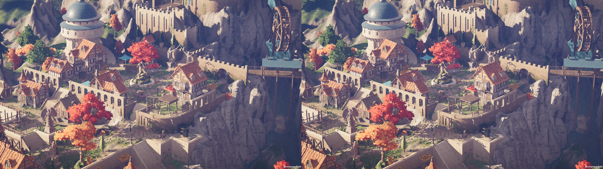
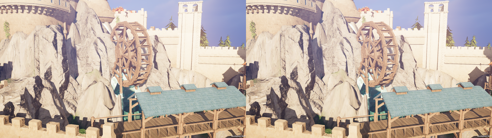
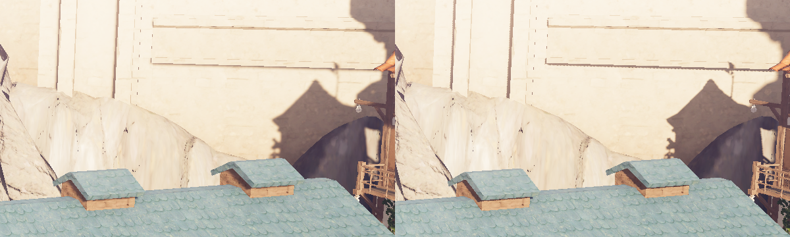

# PCF／PCSSの計測・画像比較

PCSSはPCFに対して、初期視点で全体GPU時間が約17%、影の多い視点で約6%増えた。増加は主に影を受ける不透明描画に現れた。影マップ生成は両方式とも残り、生成コストはほぼ同じだった。ニューラル近似・学習は未着手。

## 条件

- Unity 6000.3.12f1 / URP 17.3.0 / RTX 4070 SUPER / Direct3D12。1920×1080、renderScale=1、Desktop、Mono x64 Development。VSync・FPS上限・動的解像度・TAA/STPなし。
- PCF: 元のURP High、7×7 tent、16比較サンプル。保存済みPlayerを再使用。PCSS: 光源角直径0.53°、遮蔽物探索32、フィルタ32比較サンプル、最大半径32テクセル。詳細は[実装](pcss-implementation.md)。
- シーン・カメラ・光・材質・8192影アトラス・4カスケードを維持。300フレームのウォームアップ後、各1000フレーム×3回。シミュレーションは1/60秒刻み。
- 各回は初期視点→shadow-stress視点。方式の順序は1回目PCF→PCSS、2回目PCSS→PCF、3回目PCF→PCSS。Playerを並列実行せず、Editorを接続しない。
- 主系列はPlayer自身が保存したGPU Usageログ。Development計測の値であり、ProfilerなしのRelease性能やPresentMonによる独立確認値ではない。
- 撮影は計測と別起動。両方式とも310フレーム目、シミュレーション時刻5.15秒、同期読み戻し。4枚とも終了コード0で、視点ごとの撮影状態が完全一致した。
- PCF Playerの366ファイルの保存済みハッシュがすべて一致。両Playerは再ビルドによりAssembly-CSharpの識別子・ハッシュが異なるが、型／フィールド／メソッドの宣言と全IL命令列は一致した。[検証記録](../Benchmarks/ShadowComparison/runtime-identity.json)。

## 全体GPU時間

単位ms。各行は1回分の分布。p95は各回の95パーセンタイル。

| 視点 | 方式 | 回 | 有効／1000 | 中央値 | p95 |
|---|---|---:|---:|---:|---:|
| initial | PCF | 1 | 1000 | 1.622 | 1.681 |
| initial | PCF | 2 | 1000 | 1.624 | 1.659 |
| initial | PCF | 3 | 1000 | 1.613 | 1.954 |
| shadow-stress | PCF | 1 | 1000 | 2.213 | 2.442 |
| shadow-stress | PCF | 2 | 1000 | 2.259 | 2.589 |
| shadow-stress | PCF | 3 | 1000 | 2.259 | 2.322 |
| initial | PCSS | 1 | 999 | 1.837 | 2.175 |
| initial | PCSS | 2 | 1000 | 1.922 | 1.951 |
| initial | PCSS | 3 | 1000 | 1.893 | 2.038 |
| shadow-stress | PCSS | 1 | 1000 | 2.402 | 2.906 |
| shadow-stress | PCSS | 2 | 1000 | 2.375 | 2.414 |
| shadow-stress | PCSS | 3 | 1000 | 2.394 | 2.730 |

3回それぞれの中央値の中央値は、initialがPCF 1.622 → PCSS 1.893 ms（+0.271 ms、+16.7%）、shadow-stressが2.259 → 2.394 ms（+0.135 ms、+6.0%）。全フレームをまとめた中央値ではない。

## 処理別

以下も3回の中央値の中央値、単位ms。

| 視点 | 処理 | PCF | PCSS |
|---|---|---:|---:|
| initial | 影マップ生成 | 0.325 | 0.317 |
| initial | 不透明描画 | 0.584 | 0.859 |
| initial | 半透明描画 | 0.041 | 0.055 |
| shadow-stress | 影マップ生成 | 1.250 | 1.245 |
| shadow-stress | 不透明描画 | 0.359 | 0.500 |
| shadow-stress | 半透明描画 | 0.039 | 0.049 |

PCSSの評価は受光側の描画に含まれる。フィルタだけを独立計時していないため、不透明描画時間をPCSS単独のコストとは扱わない。影マップ生成の数µsの差は反復間の変動範囲にあり、生成の高速化は確認できない。各パスの中央値の和は全体時間に一致するとは限らない。

## 欠測

- FrameTimingManagerのGPU時間0はPCF 47/6000点、PCSS 761/6000点。元のframes.csvに0を残し、統計では欠測扱い。補間・他系列からの埋め合わせはしていない。
- GPU UsageとFrameTimingManagerはフレーム開始QPCで対応付ける。誤差0.05 ms以下かつ隣接フレーム間隔の1%以下、一対一を条件にした。
- PCSS initialの1回目・sample=560は誤差0.061700 ms、隣接間隔の2.13%で条件を超えた。その1点はGPU Usage側をAlignmentRejectedとして欠測化し、999点で集計。元ログは保存。残り11回は各1000点が対応。FrameTimingManager側の値には影響させない。

## 画面比較

すべて左PCF／右PCSS。全体比較は原寸を各960×540へ縮小。切り抜きは原寸600×360を横に並べたもので、補間拡大なし。







壁の屋根影や細い影の輪郭が変わる。今回の0.53°の設定では画面全体の変化は小さく、PCSSが一律に柔らかくなる結果ではない。右側の壁面の影では細かな段差・サンプル模様も見えるため、画質が全般的に改善したとは判断しない。接触から離れるほど半影が広がる性質を定量検証する専用配置や、移動中のちらつき比較は今回行っていない。

原寸PNG: [PCF initial](../Benchmarks/Captures/ShadowComparison/Comparison/PCF/initial.png)、[PCSS initial](../Benchmarks/Captures/ShadowComparison/Comparison/PCSS/initial.png)、[PCF shadow-stress](../Benchmarks/Captures/ShadowComparison/Comparison/PCF/shadow-stress.png)、[PCSS shadow-stress](../Benchmarks/Captures/ShadowComparison/Comparison/PCSS/shadow-stress.png)。従来のPCFベースラインは別途保持。

PCFとPCSSは異なる影モデルなので、PCF画像への近さを画質の正解とは扱わない。今回の画像は最終出力の8bit PNGであり、線形HDRの可視率バッファではない。

## 保存先と再実行

- [各回・各処理のCSV](../Benchmarks/ShadowComparison/comparison-timings.csv)、[反復の集計](../Benchmarks/ShadowComparison/comparison-aggregate.csv)、[設定・Playerハッシュ・撮影状態・順序](../Benchmarks/ShadowComparison/comparison-manifest.json)。
- `Benchmarks/Candidates/{pcf,pcss}-comparison-20261107/`: Playerログ、実行結果、frames.csv、GPU Usageの書き出し、対応付けたmatched-frames.csv。
- `LocalData/Candidates/{pcf,pcss}-comparison-20261107/`: 元のGPUプロファイルと撮影時の詳細ログはローカル保存対象。上記の比較用PNGはGitに保存する。

新しい保存名を指定し、プロジェクト直下で次の順に実行する。既存のrunは上書きしない。PCFは保存済みPlayer、PCSSは現在のDevelopment Playerを使用する。

```powershell
./Tools/Run-ShadowComparison.ps1 -Suffix new-run -Mode Measure
./Tools/Run-ShadowComparison.ps1 -Suffix new-run -Mode Capture
./Tools/Run-ShadowComparison.ps1 -Suffix new-run -Mode Export
python Tools/Summarize-Candidates.py --phase pcf-comparison-new-run
python Tools/Summarize-Candidates.py --phase pcss-comparison-new-run
./Tools/Verify-ComparisonRuntime.ps1
python Tools/Package-ShadowComparison.py --suffix new-run
```
